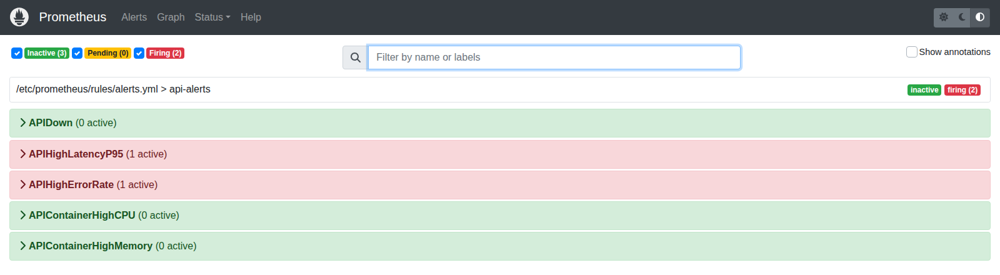
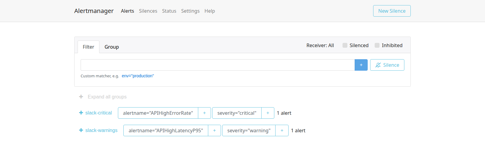

# Alerting

Prometheus evaluates the rules every 5 s and pushes firing alerts to Alertmanager, which routes them to Slack.

## Recording rules

[prometheus/rules/recording.yml](../prometheus/rules/recording.yml) precomputes the three numbers the alerts and the dashboard share:

| Rule | Expression |
|---|---|
| `api:http_requests:rate1m` | `sum(rate(http_requests_total{job="api"}[1m]))` |
| `api:http_errors:ratio_rate1m` | 5xx rate ÷ total rate (`clamp_min(…, 1e-9)` avoids ÷0 at idle) |
| `api:http_request_duration_seconds:p95_1m` | `histogram_quantile(0.95, sum by (le) (rate(…_bucket[1m])))` |

## Alert rules

[prometheus/rules/alerts.yml](../prometheus/rules/alerts.yml)

| Alert                    | Condition                                        | For | Severity |
|--------------------------|--------------------------------------------------|-----|----------|
| `APIDown`                | Prometheus can't scrape the API                  | 30s | critical |
| `APIHighLatencyP95`      | p95 latency > 500 ms                             | 1m  | warning  |
| `APIHighErrorRate`       | 5xx responses > 5 % of traffic (at > 0.5 req/s)  | 1m  | critical |
| `APIContainerHighCPU`    | API container > 80 % of one core                 | 2m  | warning  |
| `APIContainerHighMemory` | API container > 85 % of its memory limit         | 2m  | warning  |

The `rate > 0.5` guard on the error alert stops one failed request at idle from being a "100 % error rate".



## Rule unit tests

[prometheus/tests/alerts.test.yml](../prometheus/tests/alerts.test.yml) feeds synthetic series into the rules and asserts which alerts fire, including the rendered annotation text. Runs in the Prometheus image, no stack needed:

```bash
make test-rules     # promtool test rules alerts.test.yml   -> SUCCESS (4 cases)
make check-config   # promtool check config + amtool check-config
```

Cases: API down goes pending then firing; 20 % error ratio fires; healthy traffic stays quiet; all-slow traffic fires the latency alert with p95 = 975 ms.

## Alertmanager

[alertmanager/alertmanager.yml](../alertmanager/alertmanager.yml)

- Groups by `alertname, severity`; `group_wait: 10s` so a burst becomes one message; `group_interval: 1m`.
- Default route → `slack-warnings` (`repeat_interval: 1h`). `severity="critical"` → `slack-critical` (`repeat_interval: 15m`).
- Inhibit rule: a critical alert mutes the warning with the same `alertname`.
- `send_resolved: true` on both receivers, so Slack gets the all-clear.
- Message format in [templates/slack.tmpl](../alertmanager/templates/slack.tmpl).



### Slack webhook

Alertmanager does not expand environment variables in its config, and the webhook is a secret. [entrypoint.sh](../alertmanager/entrypoint.sh) writes `$SLACK_WEBHOOK_URL` to `/tmp/slack_webhook_url` and `exec`s Alertmanager; the config reads it with `api_url_file`. The URL lives in `.env` (gitignored).

What Alertmanager posts for the error-rate alert, captured during a chaos run:

```json
{
  "username": "Alertmanager",
  "attachments": [{
    "title": "[FIRING:1] APIHighErrorRate",
    "color": "danger",
    "text": "*API 5xx error rate is above 5%* (`critical`)\n23.02% of requests have failed with a 5xx over the last minute.\nStarted: 10:11:00 UTC"
  }]
}
```

The latency alert arrives the same way with `color: "warning"`, and a `[RESOLVED] …` message in green follows about 90 s after the traffic stops.
