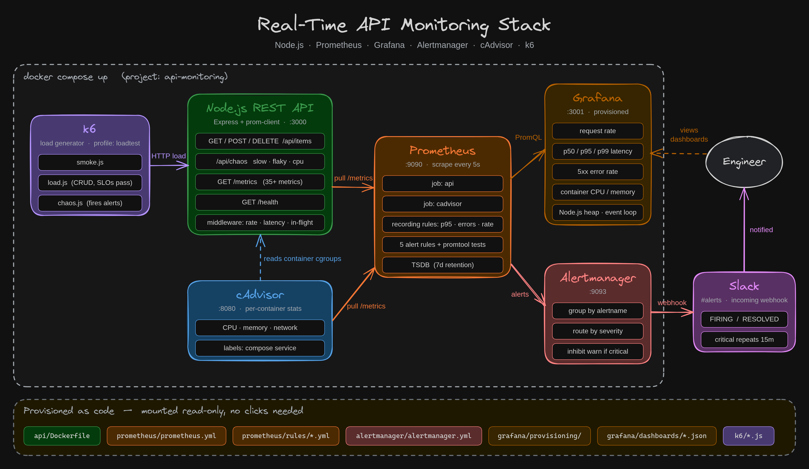

# Architecture

> Editable source: [architecture.excalidraw](architecture.excalidraw). Open it at [excalidraw.com](https://excalidraw.com) with *File → Open*.

## Data flow

1. **k6** sends HTTP traffic to the API (`smoke`, `load`, or `chaos` profile).
2. The **Node.js API** (Express + prom-client) serves requests and exposes everything it measured on `GET /metrics`.
3. **cAdvisor** reads cgroup accounting for every container and exposes CPU, memory and network per service.
4. **Prometheus** pulls `/metrics` from both every 5 s (10 s for cAdvisor), stores the series, and evaluates recording and alert rules on the same interval.
5. Firing alerts are pushed to **Alertmanager**, which groups them, routes by severity, and posts to **Slack** through an incoming webhook (firing and resolved).
6. **Grafana** queries Prometheus with PromQL and shows the provisioned *API Overview* dashboard.

Everything runs from one `docker-compose.yml`. Grafana's datasource and dashboard, the Prometheus config and rules, and the Alertmanager config are files in the repo, mounted read-only.

## Services

| Service      | URL                   | Purpose                                     |
|--------------|-----------------------|---------------------------------------------|
| API          | http://localhost:3000 | Instrumented Express REST API (TypeScript)  |
| Grafana      | http://localhost:3001 | Dashboards (login `admin` / `admin`)        |
| Prometheus   | http://localhost:9090 | Metrics storage, recording and alert rules  |
| Alertmanager | http://localhost:9093 | Alert grouping, routing and Slack delivery  |
| cAdvisor     | http://localhost:8080 | Per-container CPU, memory and network usage |
| k6           | —                     | Load generator, only runs on demand         |

## Why these choices

- **Pull, not push.** The app only serves text on `/metrics`; Prometheus controls the sampling rate and can tell when a target is down (`up == 0`).
- **Fixed Compose project name** (`api-monitoring`): cAdvisor labels containers with the project name, and the dashboard filters on it, so it must not depend on the folder the repo was cloned into.
- **Resource limits on the API container**: the memory alert divides usage by the limit, so there has to be one.
- **Alertmanager separate from Prometheus**: Prometheus decides *what* is firing; Alertmanager decides *who* hears about it and how often.
