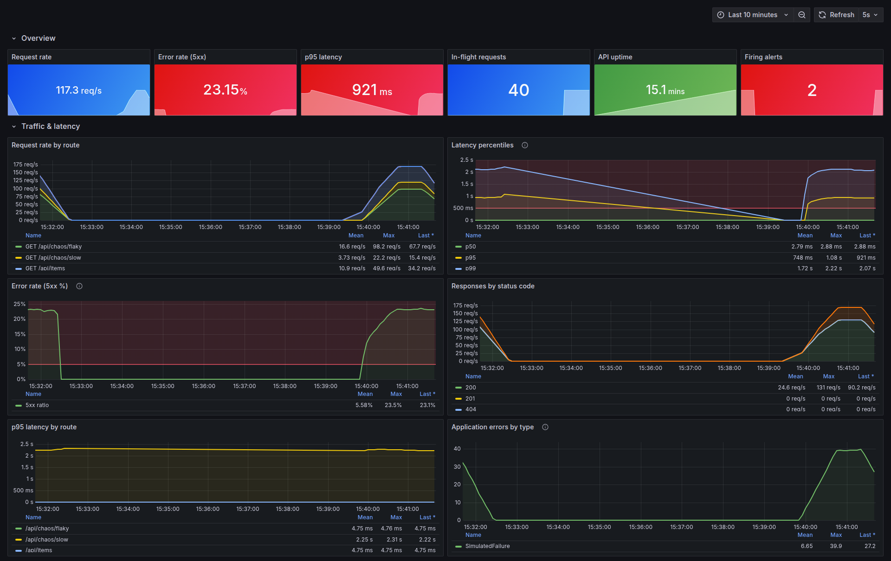

# Grafana dashboard

[grafana/dashboards/api-overview.json](../grafana/dashboards/api-overview.json) — 22 panels, refreshes every 5 s, default window 15 minutes. Provisioned from file and set as Grafana's home dashboard, so there is nothing to import or click.

*Taken during `make chaos`: error rate and p95 cross their thresholds (red bands), and the **Firing alerts** stat shows both alerts active.*

## Rows

| Row | Panels |
|---|---|
| **Overview** (stats) | request rate, 5xx error rate, p95 latency, in-flight requests, API uptime, firing alerts |
| **Traffic & latency** | request rate by route, p50/p95/p99 latency with the 500 ms alert line, 5xx error rate with the 5 % alert line, responses by status code, p95 by route, application errors by type |
| **Containers (cAdvisor)** | CPU, memory (working set) and network I/O per compose service |
| **Node.js runtime** | heap used/total + RSS, event loop lag p99/mean, process CPU user/system |

The error-rate and p95 stats turn orange and then red at the same values the alerts use (1 % / 5 % and 250 ms / 500 ms), so the overview row matches the alert state.

## Provisioning

- [provisioning/datasources/prometheus.yml](../grafana/provisioning/datasources/prometheus.yml): the Prometheus datasource with a **fixed `uid: prometheus`**. The dashboard JSON references the datasource by uid; without pinning it, every panel in a fresh Grafana would show "datasource not found".
- [provisioning/dashboards/dashboards.yml](../grafana/provisioning/dashboards/dashboards.yml): a file provider that loads everything in `/var/lib/grafana/dashboards` into the *API Monitoring* folder.
- `GF_DASHBOARDS_DEFAULT_HOME_DASHBOARD_PATH` in `docker-compose.yml` makes it the home page.

If you change the dashboard in the Grafana UI, export the JSON (*Share → Export*) back into `grafana/dashboards/`. The provider has `allowUiUpdates: false`, so UI edits aren't persisted otherwise.
